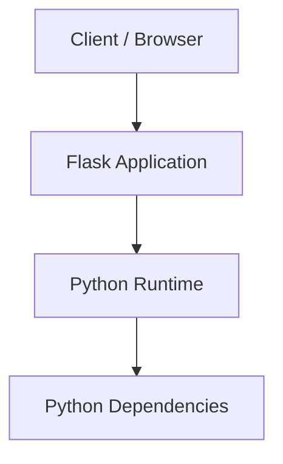
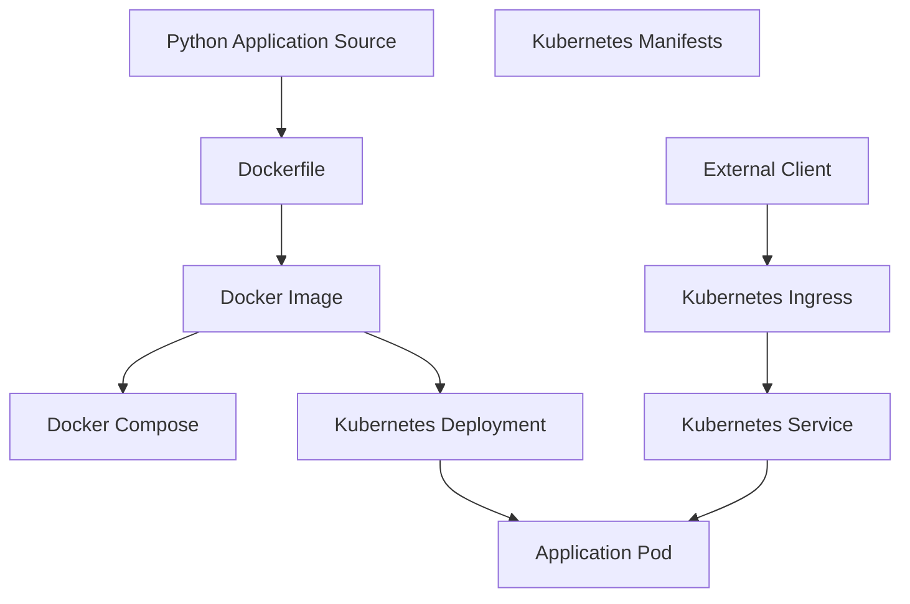

# Python Flask DevOps Project


A containerized Python Flask application demonstrating application packaging, Docker-based deployment, Kubernetes orchestration, and offline Python dependency installation.

## Overview

This project demonstrates how to package and deploy a Python Flask application using modern containerization and orchestration tools.

The application can be built and executed using Docker, managed through Docker Compose, and deployed to a Kubernetes cluster.

An additional focus of this project is **offline dependency management**. Python packages are stored locally in the `packages/` directory, allowing dependencies to be installed without downloading them from the internet.

## Architecture

The following diagram illustrates the high-level application architecture:



## Technology Stack

| Technology | Purpose |
|---|---|
| Python 3.12 | Application runtime |
| Flask | Web application framework |
| Docker | Application containerization |
| Docker Compose | Container lifecycle management |
| Kubernetes | Container orchestration |
| Kubernetes Deployment | Application workload management |
| Kubernetes Service | Internal application networking |
| Kubernetes Ingress | External HTTP routing |
| pip | Python dependency management |

## Key Features

- Python Flask web application.
- Docker image build and container execution.
- Docker Compose configuration.
- Kubernetes Deployment, Service, and Ingress manifests.
- Offline Python dependency installation using locally stored wheel packages.
- Separation of application code and deployment configuration.

## Project Structure

```text
.
├── app/
│   └── main.py
├── packages/
│   └── Python wheel packages
├── k8s/
│   ├── deployment.yaml
│   ├── service.yaml
│   └── ingress.yaml
├── Dockerfile
├── docker-compose.yml
├── requirements.txt
├── ci_generate_html.py
└── README.md
```

## Offline Dependency Installation

This project includes locally stored Python packages in the `packages/` directory.

Install dependencies using the local package repository:

```bash
pip install --no-index --find-links=packages -r requirements.txt
```

This approach is useful in restricted environments where direct access to public package repositories is unavailable.

## Docker Deployment

Build the Docker image:

```bash
docker build -t python-flask-devops .
```

Run the container:

```bash
docker run -d --name flask-app python-flask-devops
```

The container port and host port mapping should follow the port configuration defined in the Dockerfile and application.

## Docker Compose

Build and start the application using Docker Compose:

```bash
docker compose up -d --build
```

Check running containers:

```bash
docker compose ps
```

Stop the application:

```bash
docker compose down
```

## Kubernetes Deployment

The Kubernetes manifests are available in the `k8s/` directory.

Apply the manifests:

```bash
kubectl apply -f k8s/
```

Check the deployed resources:

```bash
kubectl get deployments
kubectl get pods
kubectl get services
kubectl get ingress
```

Check application logs:

```bash
kubectl logs <pod-name>
```

The Ingress resource requires a compatible Ingress Controller to be installed and configured in the Kubernetes cluster.

## Deployment Workflow



## Configuration

Application and deployment settings are maintained in the corresponding project files:

- `requirements.txt`: Python dependencies.
- `Dockerfile`: Container image build instructions.
- `docker-compose.yml`: Local container orchestration.
- `k8s/deployment.yaml`: Kubernetes workload configuration.
- `k8s/service.yaml`: Kubernetes networking configuration.
- `k8s/ingress.yaml`: External HTTP routing configuration.

## Troubleshooting

**Check Docker containers:**

```bash
docker ps -a
```

**Inspect container logs:**

```bash
docker logs flask-app
```

**Check Kubernetes resources:**

```bash
kubectl get all
```

**Inspect a Kubernetes Pod:**

```bash
kubectl describe pod <pod-name>
```

## Future Improvements

Potential improvements for this project include:

- CI/CD pipeline integration.
- Container image vulnerability scanning.
- Kubernetes resource limits and health probes.
- Application monitoring and centralized logging.
- Helm-based Kubernetes deployment.
- Automated deployment validation.

## Project Focus

This project focuses on practical DevOps skills, including:

- Application containerization.
- Docker-based deployment.
- Kubernetes resource management.
- Offline dependency management.
- Deployment configuration and troubleshooting.


## Documentation

| Document | Description |
|---|---|
| [Architecture](docs/architecture.md) | Application and infrastructure architecture |
| [Deployment Guide](docs/deployment.md) | Docker and Kubernetes deployment instructions |
| [CI/CD Strategy](docs/ci-cd.md) | Proposed CI/CD workflow and future improvements |


Detailed project documentation:

| Document | Description |
|---|---|
| [Architecture](docs/architecture.md) | Application and infrastructure architecture |
| [Deployment Guide](docs/deployment.md) | Docker and Kubernetes deployment |
| [CI/CD Strategy](docs/ci-cd.md) | Proposed CI/CD workflow |

## Project Highlights

- Containerized Python Flask application.
- Docker and Docker Compose deployment.
- Kubernetes workload orchestration.
- Offline Python dependency installation.
- Infrastructure and deployment documentation.

## Author

**Mahbod Rahimian**

DevOps Engineer | Infrastructure Automation | Containerization | Kubernetes
