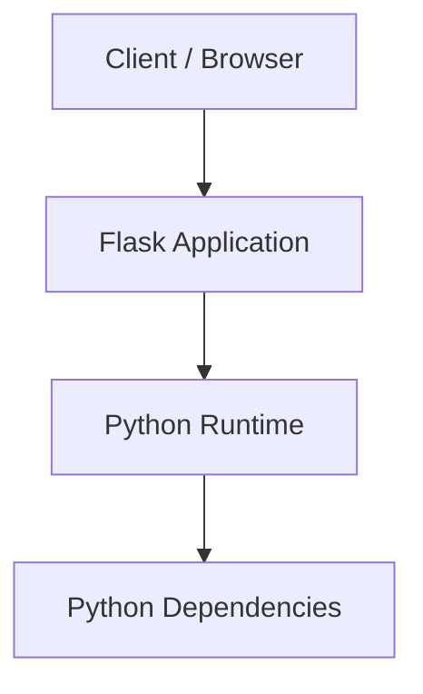
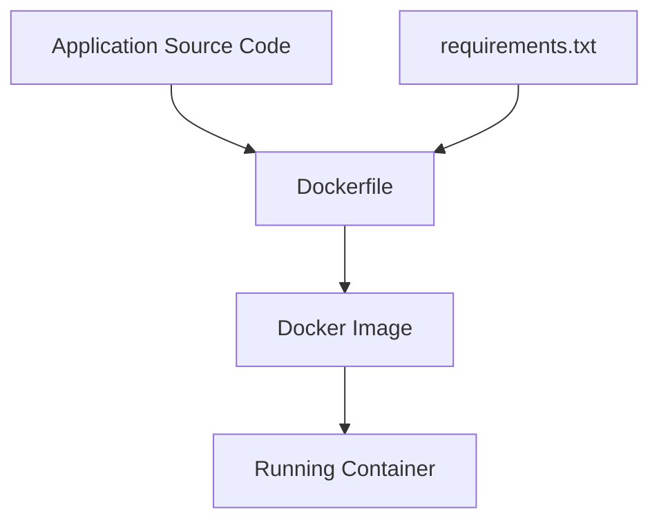
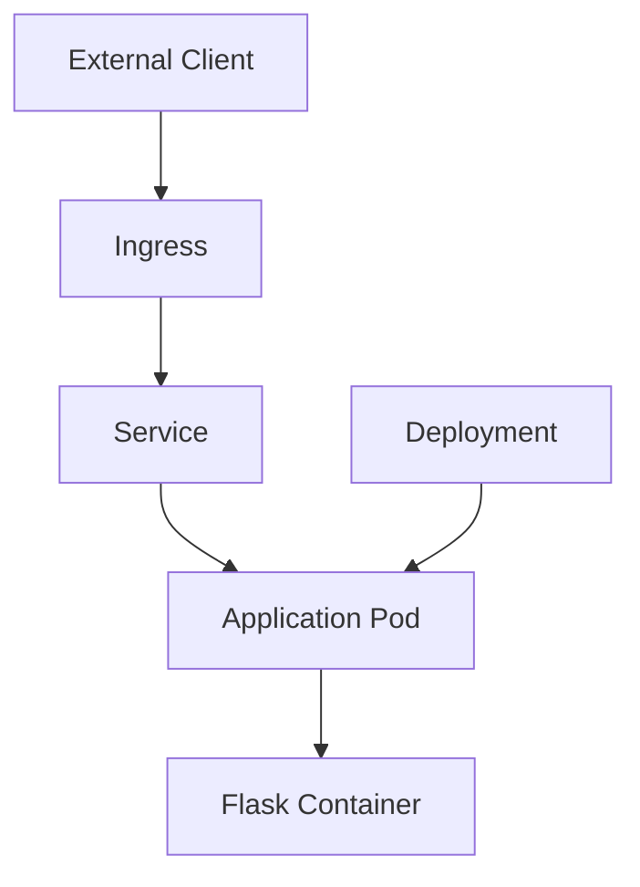
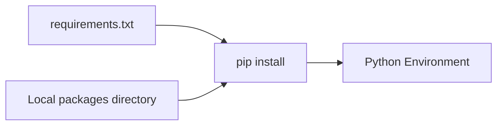

# Application Architecture

## Overview

This document describes the high-level architecture of the Python Flask application and its deployment components.

The project uses a containerized deployment model, allowing the application to run locally with Docker and Docker Compose or on a Kubernetes cluster.

## High-Level Architecture



## Application Components

| Component | Responsibility |
|---|---|
| Flask | Handles HTTP requests and application logic |
| Python Runtime | Executes the application |
| requirements.txt | Defines Python dependencies |
| packages/ | Stores local Python wheel packages |

## Container Architecture

Docker is used to package the application and its runtime dependencies into a portable container image.



## Kubernetes Architecture

The Kubernetes deployment consists of the following resources:



### Kubernetes Components

- **Deployment:** Maintains the desired number of application Pods.
- **Pod:** Runs the application container.
- **Service:** Provides stable network access to application Pods.
- **Ingress:** Provides HTTP routing from outside the cluster.

The Ingress resource requires a compatible Ingress Controller.

## Offline Dependency Management

The project includes a local package directory to support dependency installation in restricted or offline environments.



Install dependencies using:

```bash
pip install --no-index --find-links=packages -r requirements.txt
```

## Design Considerations

- Containerization separates the application from the host environment.
- Docker Compose simplifies local container execution.
- Kubernetes provides workload orchestration and service networking.
- Offline dependency installation reduces reliance on external package repositories.

---

**Note:** This document describes the logical architecture. Exact ports, resource limits, replica counts, and runtime configuration should be taken from the actual Docker and Kubernetes configuration files.
