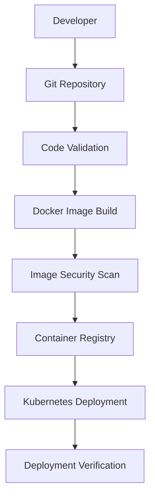

# CI/CD Strategy

## Overview

This document describes a proposed Continuous Integration and Continuous Deployment workflow for the Python Flask application.

The repository currently contains application source code, containerization configuration, and Kubernetes manifests.

A CI/CD pipeline can be integrated to automate application validation, Docker image building, image publishing, and Kubernetes deployment.

## Proposed Pipeline

## Proposed Pipeline Stages

| Stage | Responsibility |
|---|---|
| Source | Retrieve application source code |
| Validation | Validate application configuration and dependencies |
| Build | Build the Docker image |
| Security Scan | Scan the container image for vulnerabilities |
| Push | Publish the image to a container registry |
| Deploy | Deploy the application to Kubernetes |
| Verification | Verify deployment status and application availability |

## Potential Improvements

- Integrate GitLab CI/CD or GitHub Actions.
- Automate Docker image builds.
- Publish versioned images to a container registry.
- Add container image security scanning.
- Automate Kubernetes deployments.
- Add deployment health checks.

## Current Implementation Status

The workflow described in this document is a proposed CI/CD design, not a claim that all pipeline stages are currently implemented.

Implementation status should be updated when the corresponding pipeline configuration is added to the repository.
