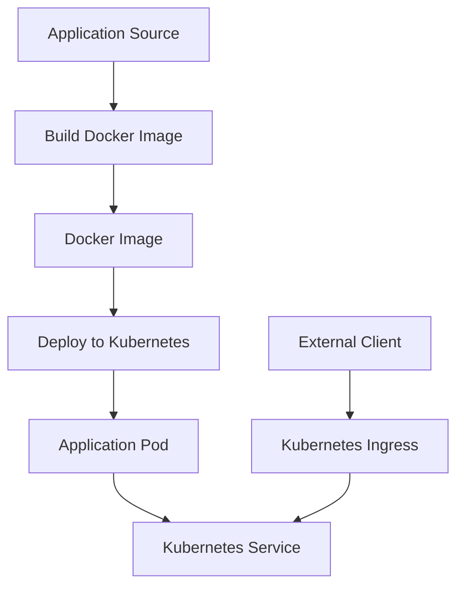

# Deployment Guide

## Overview

This document describes the available deployment methods for the Python Flask application.

The project supports container-based deployment using Docker and Docker Compose, as well as orchestration through Kubernetes.

## Prerequisites

Depending on the deployment method, the following tools are required:

- Python 3.12
- pip
- Docker Engine
- Docker Compose
- kubectl
- A running Kubernetes cluster (for Kubernetes deployment)

## 1. Python Environment

Install the required dependencies:

```bash
pip install -r requirements.txt
```

For offline installation, use the locally available wheel packages:

```bash
pip install --no-index --find-links=packages -r requirements.txt
```

## 2. Docker Deployment

Build the application image:

```bash
docker build -t python-flask-devops .
```

Run the container:

```bash
docker run -d --name flask-app python-flask-devops
```

Check the container:

```bash
docker ps
```

View container logs:

```bash
docker logs flask-app
```

**Note:** Configure port publishing according to the actual application port and Dockerfile configuration.

## 3. Docker Compose Deployment

Start the application:

```bash
docker compose up -d --build
```

Check running services:

```bash
docker compose ps
```

View logs:

```bash
docker compose logs
```

Stop the application:

```bash
docker compose down
```

## 4. Kubernetes Deployment

The Kubernetes manifests are stored in the `k8s/` directory.

Apply the manifests:

```bash
kubectl apply -f k8s/
```

Check deployments:

```bash
kubectl get deployments
```

Check Pods:

```bash
kubectl get pods
```

Check Services:

```bash
kubectl get services
```

Check Ingress resources:

```bash
kubectl get ingress
```

Inspect a Pod:

```bash
kubectl describe pod <pod-name>
```

View application logs:

```bash
kubectl logs <pod-name>
```

## 5. Deployment Flow



## Troubleshooting

### Docker container is not running

```bash
docker ps -a
docker logs flask-app
```

### Kubernetes Pod is not starting

```bash
kubectl get pods
kubectl describe pod <pod-name>
kubectl logs <pod-name>
```

### Kubernetes resources are not available

```bash
kubectl get all
kubectl get events --sort-by=.metadata.creationTimestamp
```

---

**Note:** Commands and configuration values must match the actual project manifests and application settings. This guide does not assume a specific application port or Kubernetes namespace.
